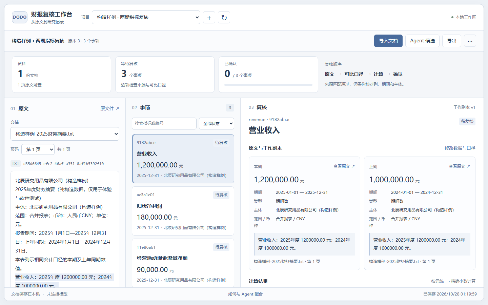

# 财报复核工作台

将自己的财报资料交给现有 Agent 提取候选，再在独立工作台中核对原文、计算变化、修正并确认，最后导出一份带来源的记录。

**本地运行，无需给本工具配置模型 API Key。** 工具不调用模型；Agent 负责提出候选，工作台负责确定性检查和人工复核。首次使用可加载“构造样例”，也可以直接导入自己的资料。



[下载本地试用包](https://github.com/Xiaor-188/filing-review-workbench/releases/latest) · [完整 Agent 启动提示词](docs/启动提示词.txt)

## 开始使用

需要 **Node.js 24 或以上**，首次安装依赖需要网络。[Node.js 下载](https://nodejs.org/en/download)

下载 Release 中的试用 ZIP 并解压。Windows 双击 `启动工作台.cmd`；macOS/Linux 在文件夹中运行 `sh start.sh`。或手动执行：

```sh
npm ci --ignore-scripts
npm start
```

在浏览器或支持本地网页的 Agent 预览面板中打开 **http://127.0.0.1:4318/**。这是独立工作台，没有作品集长文。保持启动终端运行；关闭进程后服务停止，下次启动可恢复已保存项目。

## 用自己的资料

1. 在工作台新建项目，导入 PDF、TXT 或 CSV。
2. 点击 Agent 使用说明，或将下方提示词交给能运行本地命令的 Agent。
3. Agent 读取工作台提供的真实页文本，按统一格式提出本期和上年同期的候选数据。
4. 回到工作台刷新项目。逐项检查原文、页码、单位、期间和本期/上期列，必要时修改。
5. 勾选人工核对声明后确认。仅当前有效确认项进入事实导出；受阻、驳回和未确认项保留在待办区。

机器检查“摘录及金额出现在该页”只能证明可追溯，**不能代替对表头、列对应和会计口径的人工判断**。缺失信息会保留待核，不补成零。

## 交给现有 Agent

适用于能访问你授权的本地文件、执行 Node 命令并读取 JSON 的 Agent。它使用自己已有的模型能力；本工具提供 CLI 和本地 HTTP 接口。

复制 `docs/启动提示词.txt`，或使用这段提示：

> 请打开当前财报复核工作台项目，先阅读 README.md 和 AGENTS.md。按说明安装并启动原有工具，在预览面板或浏览器打开本地工作台，不要重写界面。只读取我指定的资料，新建独立项目，使用 scripts/agent.mjs 导入文件并取得 context。按 docs/agent-input.schema.json 生成带真实页码与原文的候选，再导入工作台。未知信息留空，遇到校验失败如实说明。所有候选保持待人工复核，不替我点击确认。最后给我工作台地址、项目名称和需要人工检查的事项。

常用命令：

```sh
npm run agent -- help
npm run agent -- create --name "我的财报复核"
npm run agent -- add --project PROJECT_ID --file "/path/to/report.pdf"
npm run agent -- context --project PROJECT_ID --out ".local-data/context.json"
npm run agent -- import --project PROJECT_ID --file ".local-data/candidates.json"
npm run agent -- export --project PROJECT_ID --format markdown --out ".local-data/review.md"
```

`PROJECT_ID` 用 create 返回的 id 替换。`candidates.json`由 Agent 按 context 生成，不是把原PDF改个扩展名。导入必须带 context 的 `expected_revision`；项目已有更新时会拒绝旧版本覆盖。完整协议见 [API说明](docs/API.md) 和 [候选格式](docs/agent-input.schema.json)。

试用构造样例也可执行 `npm run agent -- demo`。样例中的企业及数据均为虚构，仅用于体验，不是研究结论。

## 支持范围

| 支持 | 本版限制 |
|---|---|
| 可提取文字的PDF、UTF-8 TXT/CSV | 不做OCR，不解析`.xlsx`；CSV保留原行文本，不自动理解表结构 |
| 任意名称的项目、资料、指标与年度 | 首版面向人民币元/万元/亿元，以及可核对的上年同期比较 |
| 来源页码、逐字摘录、金额、期间及口径检查 | 跨文档会计口径尚未实现人工核定，保持受阻 |
| 正常同比及金额差额 | 基期为零或负数不输出普通增长率 |
| 修改、确认失效、驳回、恢复、操作记录 | 仅单机使用；不提供公网多用户权限或团队同步 |
| Markdown、CSV、JSON导出 | 未确认和受阻数据不能进入正式事实行 |

扫描件或提取不到文字的页面会显示警告。可先用你获准使用的OCR工具处理，再导入文本结果并保留原始资料供人工对照。

本包不是 ChatGPT 对话内的原生 MCP App。支持本地网页的内置浏览器可以直接打开它；普通聊天仅粘贴仓库地址不会自动安装、启动程序或获得文件访问权限。私有工作台默认禁止第三方网页iframe嵌入；若某个预览面板使用这种嵌入方式，请在普通浏览器打开本地地址。

## 本地数据

原文件、页文本、项目进度和操作记录保存在 `.local-data/`，不进入静态网页资源或 Git。停止服务后数据仍保留；删除项目会删除该项目原文和记录，操作前可先导出需要的内容。

本服务只监听本机地址，不设置开放CORS，不主动发送资料到 DODO 网站或模型服务。**你使用的外部 Agent 可能按自己的配置把资料发送给模型**；请按你所在组织允许的方式使用内部资料。

可用环境变量 `PORT` 更改端口、`FILINGS_DATA_DIR` 指定本地私有目录。`.env.example`只是字段说明，本版不会自动加载`.env`。不要把 `.local-data/`、运行token、个人文件加入仓库或转发给他人。

## 开发与验证

```sh
npm test
npm run check:release
```

领域/API测试使用隔离临时目录，不操作真实用户项目。浏览器验收另外需要 Python Playwright/Chromium，方法及证据说明见 [QA](docs/QA.md)。发布记录见 [验证记录](docs/VALIDATION.md)。测试样例与软件检查不能替代真实财务判断，也不构成模型抽取准确率报告。

项目作者：DODO · [产品案例](https://www.dodoliu.cc/labs/filing-review/) · MIT License
